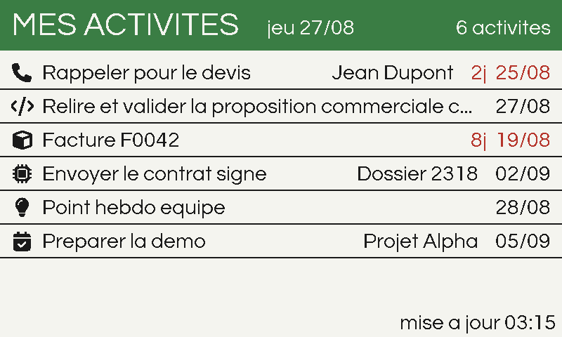

# Odoo e-Paper Dashboard — Pico 2 W, Rust firmware

Bare-metal Rust firmware ([Embassy](https://embassy.dev), no OS, no
heap — not even an allocator) for a Raspberry Pi Pico 2 W that joins
your WiFi, authenticates against a self-hosted Odoo instance over
HTTPS, and shows the signed-in user's scheduled Activities
(`mail.activity` — the items behind the clock icon in Odoo's top bar,
attached to any record: a contact, an invoice, a task...) on a
Waveshare 7.3" e-Paper HAT (E) — Spectra 6, 800x480, 6 fixed colors
(black, white, yellow, red, blue, green).

It polls Odoo's JSON-RPC API every 5 minutes but only spends a physical
refresh cycle on the panel when the activity list actually changed, or
once a day for a mandatory health refresh. Spectra 6 panels have no
partial-refresh mode, so minimizing wear means minimizing *refreshes*,
not minimizing pixels touched. Everything runs from a single async main
task with static buffers; TLS, rendering, and the network stack are all
fully heapless.

This firmware is a ground-up Rust port of the project's original C
implementation (itself a rewrite of a MicroPython prototype, still in
`micropython/` for reference). The port was done in two phases —
behavioral 1:1 first (byte-identical rendered frames, same request
bytes, same serial log strings, verified by a committed parity
fixture), then an idiomatic refactor with the parity test pinning
behavior throughout. **The retired C implementation lives on the
[`c-firmware`](../../tree/c-firmware) branch**, where it still builds
and its tests still pass. The port's full design doc, plan, and
measurements are under `docs/superpowers/` and in `MEASUREMENTS.md`
(the Rust build is ~52 KB smaller than the C one it replaced, with the
mbedTLS handshake heap spike gone entirely).

Screen layout (800x480 — 72px banner with 48px title, seven 48px rows
of 32px text, 32px footer; rendered by the firmware's own code via
`cargo run -p host-tools --bin preview`):



Each row starts with a 32px icon mirroring the Font Awesome icon
configured on the activity type in Odoo itself (the firmware fetches
each activity's `icon` class and maps it in
`dashboard-core/src/activity_icon.rs`; unknown classes fall back to a
clock), then the activity's summary (or, when the activity has no
summary, the name of the record it is attached to). The deadline
(always visible, far right) stays black until the date has passed and
turns red once it has, joined by a compact red day counter (`8j`). The
text has priority over the row: if it is too long it is truncated with
`...`, otherwise the remaining width shows the related record,
right-aligned. Bold full-width separators divide the rows. The banner
counter shows the real total of scheduled activities (fetched with a
`search_count` alongside the row query), and when more exist than the
seven visible rows the footer says how many are hidden:
`+ d'autres activites (N)`. The footer shows the timestamp of the last
*screen update*, not a live clock (a ticking clock would force a
refresh every minute, defeating the whole point).

Text is set in [Questrial](https://fonts.google.com/specimen/Questrial)
(SIL Open Font License 1.1 — see `lib/questrial/OFL.txt`), pre-rendered
at build time into 32 px and 48 px proportional bitmap glyphs
(`dashboard-core/src/font_data.rs`, generated by `tools/gen_font.py`)
since the firmware has no TTF rasterizer. To change the font, drop a
new TTF in `lib/` and run
`python tools/gen_font.py lib/yourfont/YourFont.ttf`.

Activity-type icons are rasterized the same way from
[Font Awesome Free](https://fontawesome.com) solid glyphs (icons
CC BY 4.0, font SIL OFL 1.1 — see `lib/fontawesome/LICENSE.txt`) by
`tools/gen_icons.py` into `dashboard-core/src/icon_data.rs`. To support
a new custom activity type: add its glyph codepoint to
`tools/gen_icons.py`, its `fa-...` class to the table in
`dashboard-core/src/activity_icon.rs`, rerun the generator, and
rebuild.

## 1. Hardware and wiring

- MCU: Raspberry Pi Pico 2 W (RP2350, 520 KB SRAM, CYW43439 WiFi). The
  "2 WH" (pre-soldered headers) variant is identical firmware-wise.
- Panel: Waveshare 7.3" e-Paper HAT (E), Spectra 6, 800x480.
- Bus: 4-wire SPI, but driven as bit-banged GPIO on purpose — hardware
  SPI at >= 1 MHz corrupts commands on this wiring (Dupont wires +
  ribbon cable). Do not "optimize" this back to hardware SPI without
  re-validating on real hardware; see `DRIVER_REFERENCE.md` section 2.
- **SPI Select switch on the HAT must be on 0.**

| Signal | Pico pin |
|--------|----------|
| VCC    | 3V3 OUT (pin 36) |
| GND    | GND      |
| DIN    | GP11     |
| CLK    | GP10     |
| CS     | GP9      |
| DC     | GP8      |
| RST    | GP12     |
| BUSY   | GP13     |

The pin assignment lives in one place, `main`'s `Epd::new(...)` call in
`dashboard-firmware/src/main.rs`.

Panel safety rules, all enforced in the firmware but worth knowing:

- The panel is put to sleep after every refresh, on every code path
  including failures. Leaving the panel powered outside sleep mode
  holds it at high internal voltage and causes irreversible damage.
- At least 3 minutes between refreshes (`refresh::MIN_GAP_S = 180`).
- At least one refresh every 24 hours while powered
  (`refresh::MAX_AGE_S = 86400`).
- One display push per fully-composed frame — never partial sends.

## 2. Toolchain setup, from zero

Install `rustup` (PowerShell, user-scope, no admin needed):

```powershell
winget install -e --id Rustlang.Rustup --accept-source-agreements --accept-package-agreements
rustup default stable
rustup target add thumbv8m.main-none-eabihf
rustup component add clippy rustfmt
```

`rust-toolchain.toml` pins `channel = "stable"`, the
`thumbv8m.main-none-eabihf` target, and the `clippy`/`rustfmt`
components, so any `cargo` invocation from the repo root auto-selects
(and if needed auto-installs) this exact toolchain — the explicit
`rustup` commands above are only needed once, the first time.

Versions this firmware was actually built and gated against: `rustup
1.29.1`, `rustc`/`cargo 1.99.0` (stable).

PowerShell environment preamble used before every command below (this
machine's PATH does not otherwise pick up Cargo's shims or the LLVM
tools `rust-lld` needs in every fresh shell):

```powershell
$env:Path = [Environment]::GetEnvironmentVariable('Path','Machine') + ';' + [Environment]::GetEnvironmentVariable('Path','User') + ';' + "$env:USERPROFILE\.cargo\bin" + ';C:\Program Files\Git\usr\bin;C:\Program Files\LLVM\bin'
```

**Smart App Control**: this project's dev machine has Windows Smart App
Control enabled. It did not block any freshly-compiled Rust binary
during the port. If a fresh binary is ever blocked ("Access is denied"
running a just-built `.exe`), the established workaround for this repo
is: delete the binary, rebuild, and retry — SAC reliably admits a
rebuilt binary it previously blocked.

**`picotool`**: any picotool 2.x works; this machine uses a prebuilt
install at `C:\Users\charl\picotool-install\bin\picotool.exe`
(`picotool v2.3.0`, built without USB support — the `uf2 convert`
subcommand used below doesn't need USB).

## 3. Workspace layout — and why `cargo test`/`cargo clippy` never use `--workspace`

`Cargo.toml`:

```toml
[workspace]
members = ["dashboard-core", "host-tools", "dashboard-firmware"]
default-members = ["dashboard-core", "host-tools"]
```

- `dashboard-core` — `no_std`-capable pure logic (JSON parsing, Odoo
  response parsing, graphics/text/dashboard rendering, refresh policy,
  PEM decoding), unit-tested on the host.
- `host-tools` — host-only binaries/tests: the `preview` tool and the
  frame-parity test (section 5).
- `dashboard-firmware` — the actual `no_std`/`no_main` RP2350 binary.
  **Deliberately excluded from `default-members`.** It targets
  `thumbv8m.main-none-eabihf` — `cortex-m`'s inline `asm!` (`sev`,
  `msplim`, ...) does not exist on the host `x86_64` target at all, so
  compiling it for the host is a hard compile error.
  (`cargo test --workspace`/`cargo clippy --workspace` explicitly
  override `default-members` — see Cargo's own docs — so passing either
  flag always tries to build `dashboard-firmware` for the host and
  always fails. **Never pass `--workspace` in this repo.**)

The gates below are therefore always run as **bare** `cargo`
invocations (no `-p`, no `--workspace`) from the repo root — a bare
invocation scopes to `default-members`, i.e. host-buildable code only —
plus separate, explicit `-p dashboard-firmware --target
thumbv8m.main-none-eabihf` invocations for the firmware itself.
`cargo fmt --check` is the one exception: it is scope-independent and
always formats every workspace member, firmware included.

## 4. Configuration

Copy the template and fill in real values —
`dashboard-firmware/src/config.rs` is gitignored from the first commit,
so credentials can never be committed by accident:

```powershell
cp dashboard-firmware/src/config.rs.example dashboard-firmware/src/config.rs
```

Every constant, in the order they appear in `config.rs.example`:

| Constant | Type | Meaning |
|---|---|---|
| `WIFI_SSID` / `WIFI_PASSWORD` | `&str` | Your WiFi network credentials. |
| `WIFI_COUNTRY` | `&str` | **Currently inert.** `cyw43 0.7`'s `Control::init` hardcodes the regulatory domain to `countries::WORLD_WIDE_XX` internally and exposes no parameter to override it (unlike the C firmware's `cyw43_arch_init_with_country`). The constant is kept purely for forward-compatibility with a future `cyw43` release that re-exposes per-country config. In practice this only matters for networks that require channels 12/13; ordinary channel 1-11 APs join identically either way. |
| `ODOO_HOST` | `&str` | Odoo hostname only — no `https://`, no path. |
| `ODOO_PORT` | `u16` | HTTPS port, normally `443`. |
| `ODOO_DB` | `&str` | Odoo database name. |
| `ODOO_LOGIN` | `&str` | Your Odoo login (usually an email address). |
| `ODOO_API_KEY` | `&str` | An Odoo API key (not your account password — see below). |
| `ODOO_ACTIVITY_DOMAIN` | `&str` | A JSON-RPC domain filter on `mail.activity`, with `%d` where the authenticated `uid` goes — see below. |
| `POLL_INTERVAL_S` | `u32` | Seconds between Odoo polls, default `300` (5 minutes). |
| `NTP_SERVER` | `&str` | SNTP server for time sync, e.g. `pool.ntp.org`. |
| `TZ_OFFSET_MIN` | `i32` | Local timezone offset from UTC, in minutes (no DST database — a plain fixed offset, adjust by hand across DST changes). |
| `EPD_CLK_HALF_PERIOD_US` | `u32` | Bit-bang clock half-period in microseconds. Default `1` (~500 kHz effective). Do not lower without re-validating on real hardware — see the SPI corruption warning in section 1. |
| `ODOO_CA_CERT` | `Option<&str>` | **`None`** (default): TLS still encrypts the connection but does not verify the server's identity. **`Some(pem)`**: enables real certificate-chain-of-trust, signature, and hostname (SNI) verification via `embedded-tls`'s `rustpki` verifier — a genuine `no_std` X.509 path, not a stub. **Caveat: certificate expiry is not checked** (the verifier is given no wall clock and `embedded-tls` is documented to skip the not-before/not-after window check gracefully in that case). A cert signed by the wrong CA, or presented for the wrong hostname, is still correctly rejected. If the configured PEM fails to parse, the firmware logs a warning and falls back to the unverified path rather than failing every request. |

**Keep config values free of anything that would break a `&str`
literal** (an unescaped `"` outside a raw string breaks the build).

### Creating an Odoo API key

Use an API key, not your login password: in Odoo, click your user
avatar (top right) -> **My Profile** -> **Account Security** tab ->
**New API Key**. Give it a description, confirm, and copy the key
immediately — Odoo only shows it once.

### Tuning `ODOO_ACTIVITY_DOMAIN`

The domain is a JSON-RPC filter on `mail.activity`, substituted at
request-build time: `%d` is replaced with the `uid` returned by
`authenticate`. The default,

```rust
pub const ODOO_ACTIVITY_DOMAIN: &str = "[[\"user_id\",\"=\",%d]]";
```

fetches exactly what Odoo's systray clock shows: every activity
scheduled for the signed-in user, on any record, ordered by deadline
(activities always carry one). To narrow it, extend the domain — for
example, only activities on contacts:

```rust
pub const ODOO_ACTIVITY_DOMAIN: &str =
    "[[\"user_id\",\"=\",%d],[\"res_model\",\"=\",\"res.partner\"]]";
```

No firmware code needs to change for this — it's a config-only edit.

### Optional: pinning the Odoo CA certificate

Fetch the certificate chain:

```
openssl s_client -connect ODOO_HOST:443 -showcerts
```

(run from Git Bash or WSL if `openssl` isn't on your Windows PATH).
Take the **last** `-----BEGIN CERTIFICATE-----` ... `-----END
CERTIFICATE-----` block printed (the top of the chain, i.e. the issuing
CA), and set it as a Rust string literal in your local `config.rs` (raw
strings make the embedded newlines easy):

```rust
pub const ODOO_CA_CERT: Option<&str> = Some(r#"-----BEGIN CERTIFICATE-----
MIIB...
-----END CERTIFICATE-----
"#);
```

## 5. Host tests (gates)

From the repo root, with the PATH preamble from section 2:

```powershell
cargo fmt --check
cargo clippy --all-targets -- -D warnings
cargo test
```

All three are bare invocations (see section 3) — they build and test
`dashboard-core` and `host-tools` only, never `dashboard-firmware`.

### Parity test

`host-tools/tests/parity.rs` renders a fixed sample scenario
(6 activities, total 11, today 2026-08-27, banner `jeu 27/08`, updated
`03:15`) through `dashboard_core::dashboard::render` and asserts the
resulting 192,000-byte framebuffer is **byte-for-byte identical** to
`host-tools/tests/fixtures/preview_c.raw`, a fixture generated once
from the retired C firmware's renderer and committed as ground truth.
On a mismatch, the panic message localizes the first divergent byte to
an approximate pixel `(x, y)` to make debugging tractable.

**The fixture is ground truth — do not regenerate it to make the test
pass.** A failing parity test means the renderer's behavior changed;
fix the code. The one legitimate reason to regenerate it is a
*deliberate* redesign of the dashboard layout — and since the C
renderer no longer exists on this branch, that also means the fixture
stops being "what the C firmware drew" and becomes "what the Rust
renderer drew at the moment of the redesign" (generate it with
`cargo run -p host-tools --bin preview` and copy the resulting
`preview.raw` over the fixture). The original C renderer remains
buildable on the `c-firmware` branch if a true cross-implementation
check is ever needed again.

An optional visual check: `cargo run -p host-tools --bin preview`
writes `preview.raw` in the current directory, viewable with any raw
GS4 viewer or the conversion snippet in `DRIVER_REFERENCE.md`.

## 6. Firmware build and flash

```powershell
cargo clippy -p dashboard-firmware --target thumbv8m.main-none-eabihf -- -D warnings
cargo build --release -p dashboard-firmware --target thumbv8m.main-none-eabihf
```

Both run from the repo root, same PATH preamble. The release build has
one benign, non-blocking linker warning on every build (reproduced
byte-identically upstream in embassy-rs/embassy's own `rp235x` example
`memory.x`, not gated by `-D warnings`):

```
rust-lld: address (0x1000013c) of section .text is not a multiple of alignment (8)
```

Convert the linked ELF to a flashable UF2 (any picotool 2.x):

```powershell
& "C:\Users\charl\picotool-install\bin\picotool.exe" uf2 convert `
    target\thumbv8m.main-none-eabihf\release\dashboard-firmware `
    -t elf dashboard-firmware.uf2
```

To flash the first time: hold **BOOTSEL**, plug the Pico 2 W into USB,
release BOOTSEL once it shows up as a mass-storage drive (`RP2350`),
then drag-and-drop `dashboard-firmware.uf2` onto that drive. The board
reboots and starts running automatically.

**Reflash without the button**: once this firmware is running, send the
exact text `BOOTSEL` to its USB serial port (any baud) and the board
reboots straight into the `RP2350` mass-storage bootloader — no
physical button press. This exists because the deployed Pico sits
inside its 3D-printed case where BOOTSEL is unreachable (the button is
only needed for the very first flash, or to recover from a firmware
that wedges before USB comes up — for that, `hardware/README.md`'s
"slide the lid out" procedure still applies).

Open a serial monitor at **115200 baud** on the Pico's USB serial port
(the firmware uses `embassy-usb-logger` over USB CDC-ACM, not the
SWD/debug UART) to watch the boot log — see section 7 for exactly what
to expect.

The CYW43439 WiFi firmware blobs the radio driver needs
(`43439A0.bin`, `43439A0_clm.bin`) are vendored under
`dashboard-firmware/cyw43-firmware/`, fetched from the
embassy-rs/embassy upstream repository and embedded at compile time via
`include_bytes!` — no separate flashing step for them. They carry
Infineon/Cypress's Permissive Binary License 1.0; see
`dashboard-firmware/cyw43-firmware/LICENSE-permissive-binary-license-1.0.txt`.

A third blob, `43439A0_nvram.bin`, is the radio's **NVRAM** (board
config: crystal frequency, PA tables, gSPI setup), extracted
byte-for-byte from pico-sdk's `cyw43-driver`
`firmware/wifi_nvram_43439.h` — the identical bytes the C firmware
loaded. `cyw43 0.7`'s `cyw43::new()` takes it as its fifth parameter;
it is **not** the CLM blob (that one is loaded separately by
`Control::init`). Passing the wrong bytes there is invisible to every
host-side gate — it type-checks and links — and on hardware the WLAN
core simply never comes up, so `cyw43::new()` hangs forever and the 8 s
watchdog reboot-loops the board with nothing ever logged. This was the
one bug in the entire port that only the first real hardware flash
could catch.

## 7. Log expectations

Every log line was frozen byte-exact against the C firmware's serial
output during the port. A clean boot and first successful poll looks
like:

```
wifi: retry in 5000 ms        (only if the first join attempt fails; repeats with doubling backoff, 5 s -> 80 s cap, until connected)
wifi: connected
time: synced
odoo: authenticated uid=7
odoo: 11 activities
epd: refresh start
epd: refresh done
```

Other lines that can appear, depending on conditions:

- `odoo: fetch failed (N in a row)` — a poll failed; after the 3rd
  consecutive failure the next refresh shows the offline footer.
- `epd: panel not responding` — the panel failed to come out of reset
  during init; `epd: refresh done`/`failed` is skipped for that cycle.
- `epd: refresh failed` — init succeeded but the display push did not;
  the panel is still put to sleep either way.
- `tls: ODOO_CA_CERT is not valid PEM; proceeding WITHOUT certificate
  verification` — only when `ODOO_CA_CERT` is `Some(...)` but fails to
  parse (section 4).
- `last panic: <message>` — logged once, immediately after boot
  (before the first `wifi:` line), **only on the reboot that follows a
  panic**. The panic handler stores the message in an uninitialized RAM
  section that survives a watchdog reset, then forces an immediate
  watchdog reset; the next boot reads it, logs it exactly once, and
  clears it so it is never reported twice.

Two **benign** lines from the `cyw43` driver itself (observed on real
hardware, harmless):

- `BDC event, incomplete header` — a couple of these during radio
  bring-up, before `wifi: connected`.
- `failed to push rxd packet to the channel.` — a burst of these during
  each panel refresh: the ~35 s bit-bang refresh blocks the executor (a
  faithful port of the C superloop, which equally starved lwIP during
  refreshes), so inbound WiFi packets are dropped until it finishes.
  The C firmware did the same thing silently; the Rust driver just
  logs it.

## 8. Behavior reference

- After boot (WiFi connect with exponential backoff, 5 s doubling to an
  80 s cap; SNTP time sync; one Odoo `authenticate` call caching the
  `uid`), the firmware polls Odoo's JSON-RPC API every
  `POLL_INTERVAL_S` seconds (default 300 = 5 minutes).
- The panel is refreshed only when the fetched activity snapshot
  actually changed, or at least once per 24 hours, and never less than
  3 minutes after the previous refresh — otherwise the display is left
  untouched and the panel takes zero wear.
- Three consecutive failed polls count as a state change: the firmware
  forces one refresh showing an offline footer (`HORS LIGNE depuis
  HH:MM`, in red). The next successful poll forces a refresh back to
  the normal view.
- A hardware watchdog (8 s) reboots the board if any code path stops
  feeding it. Long network waits are wrapped in a combinator that feeds
  once per second *only while the executor is actually making
  progress*, so a merely-slow network never trips it but a genuine hang
  still does.
- If the WiFi chip itself fails to initialize at boot (before any SSID
  or password is even used), the board ends up in a watchdog reboot
  loop: its USB serial port re-enumerates roughly every 10 seconds and
  nothing is ever logged. That signature always means the radio did not
  come up — not a wrong SSID or password, which instead shows as an
  endless `wifi: retry` backoff in the serial log.
- The dashboard renders ASCII only: the vendored font has no accented
  glyphs, so French accented characters coming back from Odoo (é, è, à,
  ç, ...) are folded to their unaccented equivalent while parsing the
  JSON response; any other multi-byte UTF-8 sequence becomes `?`.

## 9. Known behavior differences from the retired C firmware

- **TLS 1.3 instead of TLS 1.2**: `embedded-tls` is TLS 1.3-only (the
  C firmware's mbedTLS negotiated 1.2). Verified against the target
  Odoo server before the port began; invisible to the dashboard.
- **WiFi join security**: the join request allows WPA2 *and* WPA3
  (`cyw43`'s `JoinOptions` default) where the C firmware requested
  WPA2-AES only. On a WPA2 network this changes nothing; on a
  mixed-mode AP the association may land on WPA3 — strictly an
  upgrade.
- **`WIFI_COUNTRY` is inert** — see section 4. Low risk (affects only
  channel 12/13 regulatory behavior), flagged for whoever upgrades
  `cyw43` past 0.7 in case a country-override API reappears.
- **Pinned-CA TLS does not check certificate expiry** — see section 4.
  Chain-of-trust, signature, and hostname are still fully verified.
  (The C firmware skipped the expiry check too — its mbedTLS build had
  no wall-clock date support — so this matches, it just deserves
  stating.)
- **One silent WiFi rejoin per poll**: if the association drops,
  `poll_once` attempts exactly one silent rejoin per poll cycle before
  falling through to the normal fetch (which then fails and drives the
  existing offline-footer bookkeeping) rather than retrying in a tight
  loop.

## 10. Troubleshooting

- **Panel completely unresponsive** (serial log shows `epd: panel not
  responding`): almost always a loose Dupont wire on CLK/DIN/DC/CS, or
  the SPI Select switch not on 0. Full diagnostic order in
  `DRIVER_REFERENCE.md` section 6.
- **USB serial port appears and disappears every ~10 s, nothing
  logged**: watchdog reboot loop before the first log line — the WiFi
  radio did not come up (section 8). If it started after touching the
  radio bring-up code, check the NVRAM blob story in section 6.
- **Text renders wrong or a glyph looks broken**: the font is
  pre-rendered bitmap data generated from the TTF — regenerate with
  `python tools/gen_font.py lib/questrial/Questrial-Regular.ttf` after
  any font change, then rebuild.
- **Build fails with `file not found for module config`**: see
  section 4 — copy `config.rs.example` to
  `dashboard-firmware/src/config.rs` and fill it in.
- **Offline footer shows even though WiFi is clearly up**: check
  `ODOO_HOST`/`ODOO_PORT`/`ODOO_DB`/`ODOO_LOGIN`/`ODOO_API_KEY`, and
  whether `ODOO_ACTIVITY_DOMAIN` only uses `mail.activity` fields
  (section 4).
